<!--
  Profile README for github.com/Praneet-R-S
  Change text, projects, highlights and links in profile.config.json, not in the SVGs.
  The blocks between START/END markers are rewritten automatically by scripts/render.py.
-->

  

<!-- LINKS:START -->

  
&nbsp;
  

<!-- LINKS:END -->

  

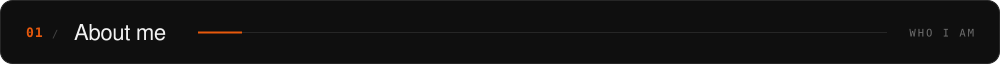

  

I build AI systems end to end: the model, the API around it, and the product someone actually uses. I study Computer Science at **SRM University** (CGPA 9.68) and work as an **AI/ML Intern at Flexidigit Technologies**, where I architected a reusable multi-agent orchestration engine with **CrewAI** and **n8n** and built **RAP**, a recruitment automation platform in which nine AI agents read job posts, find candidates and rank a shortlist.

- **Now:** shipping production multi-agent workflows at Flexidigit, backed by 111 automated tests
- **Recently:** SANGAM, a matcher that catches duplicate part codes across government companies at 97.9% F1 and 17 ms per query
- **Beyond AI:** full-stack products like Vetri Tamil Nadu, a citizen services platform with 20+ services and 22 welfare schemes
- **Open to:** AI/ML and full-stack roles, research collaborations and hackathon teams

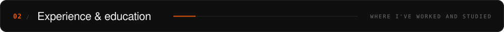

  

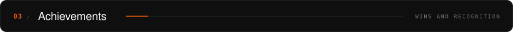

  

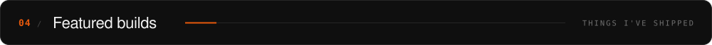

<!-- PROJECTS:START -->

  <a href="https://github.com/Praneet-R-S?tab=repositories"></a>
  <a href="https://github.com/Praneet-R-S?tab=repositories"></a>

  
  <a href="https://github.com/Praneet-R-S?tab=repositories"></a>

  

  <a href="https://github.com/Praneet-R-S/Edunexus"></a>
  <a href="https://github.com/Praneet-R-S/VetriTamilNadu_SuperApp"></a>

  <a href="https://github.com/Praneet-R-S/binly-citizen-app"></a>
  

<!-- PROJECTS:END -->

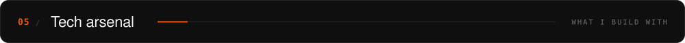

  

  

  

  

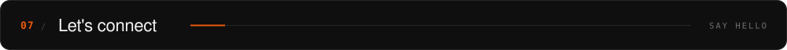

  <b>Open to AI/ML and full-stack opportunities.</b> 
  The quickest way to reach me is LinkedIn or email.

<!-- LINKS:START -->

  
&nbsp;
  

<!-- LINKS:END -->

  

